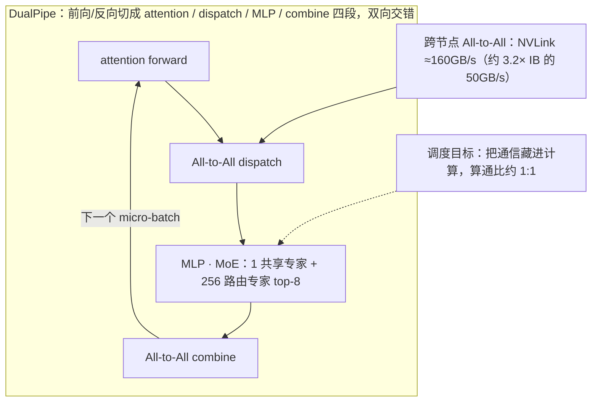
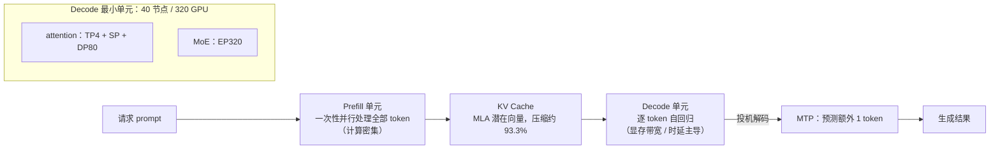

# 深入理解 DeepSeek：从训练到推理的工程实践

## 引子：一个"低成本"数字为什么值得拆

2024 年 12 月，DeepSeek-V3 发布。一个 671B 参数的模型，官方技术报告给出的全程训练成本是约 2.788M H800 GPU 小时、按 $2/GPU·小时折算约 $5.576M（[DeepSeek-V3 技术报告](https://arxiv.org/abs/2412.19437)）。这个数字之所以震动行业，不是因为某个训练技巧，而是它背后一连串"同时从显存、算力、通信三条线上抠成本"的工程决策——而且这些决策并不是孤立的优化点，而是从 V2 起就写进架构里的协同设计。

如果只看结论，很容易把 DeepSeek 理解成"会省钱"。真正值得工程团队拆解的，是它如何把成本拆成可定位的瓶颈，再逐条解决：MoE 与 MLA 解决显存和计算量，FP8 解决算力密度，DualPipe 与跨节点 All-to-All 解决通信，无辅助损失的负载均衡解决 MoE 训练稳定性。这条线从训练一路延伸到推理侧的 PD 分离、冗余专家部署，再到 R1 的强化学习路线。

## 架构：MoE + MLA 如何同时压低显存与通信

先看模型家族。DeepSeek-V2（2024.05）是 236B 总参数、每 token 激活 21B 的 MoE（Mixture of Experts，混合专家）模型，首次引入 MLA（Multi-head Latent Attention，多头潜在注意力）与 DeepSeekMoE（[V2 技术报告](https://arxiv.org/abs/2405.04434)）。到 DeepSeek-V3（2024.12），规模扩展到 671B 总参数、每 token 只激活 37B，61 层，1 个共享专家加 256 个路由专家、每 token 激活 top-8，14.8T token 预训练（[V3 技术报告](https://arxiv.org/abs/2412.19437)）。

这条主线的后续是 V3.1（2025.08），把 V3 与 R1 的能力合并进单一模型，支持「思考 / 不思考」双模式（[V3.1 公告](https://api-docs.deepseek.com/news/news250821/)）；再到 V3.2-Exp（2025.09.29）引入 DSA，Backbone 保持约 685B MoE 与 MLA，随后的 V3.2 技术报告（2025.12）在其上叠加可扩展 RL，高算力变体 V3.2-Speciale 达到 2025 IMO/IOI 金牌水平（[V3.2 技术报告](https://arxiv.org/abs/2512.02556)）。DeepSeek-Coder（1.3B–33B，2T token 从头训练）与 DeepSeekMath（7B，GRPO 出处）则是早期独立专线，其能力后来被 V3/R1 主线吸收。

这里有个极易写错的点：**671B 是总参数，不是计算量**。MoE 的价值正在于此——每 token 只走 37B 激活参数，计算量按激活参数而非总参数来算。总参数撑起了容量（能装下更多知识），激活参数决定了每一次前向的实际算力开销。稀疏 MoE 用"容量"换"算力"，是这套架构的第一层省成本逻辑。DeepSeek 版本的 MoE（DeepSeekMoE）进一步用细粒度专家切分与共享专家隔离，在同等参数量下优于 GShard 这类传统 MoE（[V2 技术报告](https://arxiv.org/abs/2405.04434)）。

但 MoE 不是免费的。把专家切分到不同卡上，就会带来两个代价：一是**通信**——每 token 要路由到分散在多个节点上的专家；二是**负载均衡**——热门专家会被频繁命中。这两点留到训练与推理两节展开。

第二层省成本逻辑是 MLA。标准 MHA 的 KV Cache 每 token 要存 `2·n_h·d_h·l` 个元素，这是显存占用的大头，直接决定了能支撑多长的上下文、多高的并发。MLA 的思路是用低秩联合压缩，把 KV Cache 压到 `(d_c+d_h^R)·l`（V2/V3 取 d_c=512、d_h^R=64），推理时只缓存潜在向量 c^KV，而 W^UK/W^UV 两个上投影矩阵可以分别吸收进 Q/O 投影里——这意味着省掉的是结构性的大头。V2 相对此前的 DeepSeek 67B，KV Cache 降了 **93.3%**、训练成本省了 42.5%、最大生成吞吐提到 5.76 倍（[V2 技术报告](https://arxiv.org/abs/2405.04434)）。

为什么重要：KV Cache 是"显存 → 并发 → 成本"这条链的起点。砍掉 93.3% 的 KV Cache，同显存下能服务的并发和上下文长度是数量级差异，这直接决定了推理的经济性。

## 训练：四件各自解决一个瓶颈

训练侧的几项工程，每一项都对应一个明确的瓶颈。

**FP8 混合精度——解决算力密度。** V3 把 GEMM 的前向和反向全放在 FP8 上，但输出与累加保留 BF16/FP32，用细粒度 tile/block 量化对抗离群值。结果是理论算力翻倍、显存下降，而相对 BF16 的损失误差小于 0.25%（[V3 技术报告](https://arxiv.org/abs/2412.19437)）。这是首次在超大模型上验证 FP8 训练可行性。注意它是**混合精度**，不是全程 FP8——敏感算子仍保留高精度，这一点常被误传。

**DualPipe——解决通信瓶颈。** 跨节点专家并行会带来约 1:1 的算通比（compute-to-communication ratio），也就是算多久几乎就要传多久。DualPipe 是一个双向流水线调度，把 forward/backward 切成 attention / dispatch / MLP / combine 四段交错排布，把 All-to-All 通信和流水线并行的通信几乎完全藏进计算里，同时减少流水线气泡（[V3 技术报告](https://arxiv.org/abs/2412.19437)）。这是整套设计里最有"工程张力"的一处：通信没有消失，而是被调度到计算的时间片里去了。

**跨节点 All-to-All 优化——解决通信带宽。** 专家并行下，token 要跨节点派发。DeepSeek 利用 NVLink（约 160GB/s，约 3.2 倍于 InfiniBand 的 50GB/s），限制每个 token 最多派发到 4 个节点、每节点约 3.2 个专家，用仅 20 个 SM 就打满带宽（[V3 技术报告](https://arxiv.org/abs/2412.19437)）。

**无辅助损失的负载均衡——解决 MoE 训练稳定性。** 传统 MoE 用辅助损失强制专家负载均匀，但会损害模型质量。DeepSeek 的做法是在专家亲和度上叠加一个动态偏置项来调节路由，不引入辅助损失（loss-free balancing），在保持负载均衡的同时避免质量损失（[V3 技术报告](https://arxiv.org/abs/2412.19437)）。

回到那个成本数字。2.788M H800 GPU 小时的构成是：预训练 2664K + 上下文扩展 119K + 后训练 5K，在 2048×H800 集群上、每万亿 token 约 180K GPU 小时（[V3 技术报告](https://arxiv.org/abs/2412.19437)）。它是 MLA（省显存）、FP8（省算力）、DualPipe/All-to-All（藏通信）三者叠加的结果，而不是某个单点训练技巧。

## 推理：Prefill 与 Decode 是两种完全不同的瓶颈

模型训好了，成本故事才到一半。推理阶段有两个阶段，瓶颈截然不同（[V3 部署章节](https://arxiv.org/abs/2412.19437)）：

- **Prefill** 一次性并行处理全部 prompt token，是**计算密集**；
- **Decode** 逐 token 自回归，受**显存带宽**（要反复读 KV Cache）和**时延**主导。

把两者混在一个服务里，就要用同一套资源同时满足两种相反的需求。于是 V3 的线上部署做了 **PD 分离（Prefill/Decode disaggregation）**：prefill 与 decode 分到不同单元，各自独立扩缩容与优化。Decode 的最小单元是 40 节点 / 320 GPU（attention 用 TP4 + SP + DP80，MoE 用 EP320），并用 IBGDA 降低 All-to-All 时延（[V3 技术报告](https://arxiv.org/abs/2412.19437)）。

显存侧，MLA 的潜在向量让 KV Cache 极小，这是支撑长上下文和高并发的根因。**MTP（Multi-Token Prediction）** 在训练时让模型额外预测 1 个 token，密集化训练信号、提升数据效率，推理时则可作投机解码加速 decode（[V3 技术报告](https://arxiv.org/abs/2412.19437)）。

最后是**专家并行下的负载不均**——这是 MoE 在线上才暴露的问题：热门专家会成为全链路瓶颈。DeepSeek 用"冗余专家"策略复制高负载专家，并对恒定高负载的共享专家单独部署；开源的 EPLB（专家并行负载均衡）提供分层（prefill，小 EP）与全局（decode，大 EP）两种再平衡算法（[deepseek-ai/EPLB](https://github.com/deepseek-ai/eplb)）。V3.2-Exp 进一步引入 **DSA（DeepSeek Sparse Attention）**：lightning indexer 打分后，每个 query 只对 top-2048 个 token 做注意力，把长上下文注意力从 O(L) 降到 O(topk)，几乎不损质量（[V3.2-Exp 仓库](https://github.com/deepseek-ai/DeepSeek-V3.2-Exp)）。

对线上指标的定性影响可以概括为四句话：KV 压缩 → 显存占用与并发提升；PD 分离 → prefill 吞吐与 decode 时延各自解耦优化；MTP → decode 速度提升；冗余专家 + EPLB → 降低尾延迟、避免个别 GPU 过载拖慢整层。具体吞吐/时延数字官方没有统一口径，这里只做方向性描述，不引用具体数值。

## R1：规则化奖励带来什么、又限制了什么

如果说 V2/V3 是"工程降本"，R1 就是"方法降本"——用更少的对齐成本换来推理能力。

核心算法是 **GRPO**（Group Relative Policy Optimization，组相对策略优化）：对同一个问题采样一组 G 个回答，用组内奖励的均值/标准差作基线计算优势，不需要独立的 critic 价值模型，因此比 PPO（Proximal Policy Optimization，近端策略优化）省显存和算力。它最早出自 DeepSeekMath（[arXiv:2402.03300](https://arxiv.org/abs/2402.03300)），在 R1 里被放大使用。换句话说，R1 的算法基础先在一台专线模型（DeepSeekMath 7B）上跑通，再被搬到通用基座上放大。

最有说服力的实验是 **R1-Zero**：直接在 V3-Base 上做大规模强化学习（RL），**不做任何监督微调（SFT）**，奖励函数只有"准确率 + 格式"两条规则。结果 AIME 2024 的 pass@1 从 15.6% 一路升到 71.0%（cons@64 达 86.7%），而且涌现出自发反思、验证、回退、按难度分配思考 token 等行为——模型没有被人教过"怎么思考"，却自己学会了（[R1 技术报告](https://arxiv.org/abs/2501.12948)）。这是整条路线里最动人的细节：思考链不是被注入的，是被奖励函数"逼"出来的。

但 R1-Zero 也有清晰的局限：输出可读性差、语言混杂、容易无尽重复。所以正式 R1 **不是纯 RL 模型**——纯 RL 只发生在 R1-Zero 这一步。正式 R1 是四阶段管线：① 冷启动 SFT（数千条高质量长思维链 CoT，注入人类先验、稳定格式）→ ② 推理导向 RL（GRPO + 语言一致性奖励）→ ③ 拒绝采样 + SFT（约 600K 推理 + 200K 通用数据，固化成功轨迹、补写作与通用能力）→ ④ 全场景 RL（推理用规则奖励、通用用偏好奖励模型）（[R1 技术报告](https://arxiv.org/abs/2501.12948)）。这是一条"涌现 → 产品化 → 放量"的混合管线，不是一步到位。

## 代价与边界：诚实地读成本，也诚实地读蒸馏

先把成本口径讲清楚。2.788M GPU 小时、$5.576M 只含**正式训练**，不含前期架构/算法/数据研究，也不含消融实验；$2/GPU·小时是租赁单价假设，不等于硬件购置成本，更不等于全公司投入。第三方对真实总投入的估算（含算力基建）显著更高，但这属于推测（[V3 技术报告](https://arxiv.org/abs/2412.19437)）。引用这个数字时，把它当成"正式训练的下界"而不是"总成本"。

再谈蒸馏与原生 RL。R1 报告给出了一个关键的对比实验：用 Qwen-32B 基座直接做 RL 得到 R1-Zero-Qwen-32B，AIME 只有 47.0%；而从 R1 蒸馏出的 Distill-Qwen-32B 却有 72.6%。官方的结论很克制：**大模型的推理模式可以被蒸馏，且优于小模型自研 RL；但要突破智能边界，仍需要更强的基座 + 更大规模的 RL**（[R1 技术报告](https://arxiv.org/abs/2501.12948)）。开源出的 6 个蒸馏模型（基于 Qwen2.5 / Llama3，1.5B–70B）只做 SFT、不追加 RL，用约 800K 条 R1 生成数据（[deepseek-ai/DeepSeek-R1](https://github.com/deepseek-ai/DeepSeek-R1)）。

V3、R1 等以 MIT 许可开放权重，直接催生了社区蒸馏与低成本复现生态，也引发了"蒸馏是否被滥用"的争论（第三方观点，未证实）。

## 结论：对做推理服务与做 Agent 的团队意味着什么

**做推理服务的团队**，DeepSeek 给的是三条可直接借鉴的工程模式：一是别盯着参数总量，要看**激活参数和 KV Cache**——这两个才是显存与带宽的真实账单；二是 PD 分离把两类瓶颈解耦，让 prefill 扩吞吐、decode 压时延各自独立；三是 MoE 线上最痛的是负载不均，冗余专家和 EPLB 是压尾延迟的成熟方案。DSA 这类稀疏注意力，则说明长上下文服务的成本不必随序列长度线性上涨。

**做 Agent 应用的团队**，R1 路线给的是另一层认知：思考 token 是**有成本、可调节的资源**——规则奖励能逼出长思维链，但也带来可读性与重复问题，所以产品化必须靠冷启动 SFT 与拒绝采样把涌现行为"固化"下来。落地层面，蒸馏模型是小规模、低成本的捷径，但它的上限被基座能力锁死；真正要突破能力边界，还得回到"更强的基座 + 更大规模 RL"这条更贵、也更慢的路上。

DeepSeek 的价值不在于"省钱"这个标签，而在于它把大模型的每一分成本都拆解成了可定位、可优化的工程问题——显存、算力、通信、负载、对齐，逐条解决。这正是工程实践最有借鉴意义的地方：不是某个魔法数字，而是一套把成本当变量来设计的方法论。

## 参考资料

- DeepSeek-V2 技术报告：https://arxiv.org/abs/2405.04434
- DeepSeek-V3 技术报告：https://arxiv.org/abs/2412.19437
- DeepSeek-V3.2 技术报告：https://arxiv.org/abs/2512.02556
- DeepSeek-R1 技术报告：https://arxiv.org/abs/2501.12948
- DeepSeek-Coder：https://arxiv.org/abs/2401.14196
- DeepSeekMath（GRPO 出处）：https://arxiv.org/abs/2402.03300
- DeepSeek-V3.1 发布公告：https://api-docs.deepseek.com/news/news250821/
- DeepSeek-V3.2-Exp 仓库：https://github.com/deepseek-ai/DeepSeek-V3.2-Exp
- EPLB（专家并行负载均衡）：https://github.com/deepseek-ai/eplb
- 官方模型仓库：https://github.com/deepseek-ai/DeepSeek-V3
- DeepSeek-R1 仓库：https://github.com/deepseek-ai/DeepSeek-R1
- 官方 API 文档：https://api-docs.deepseek.com/
